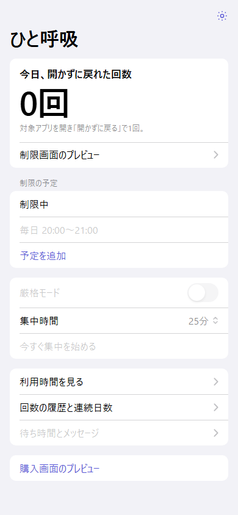
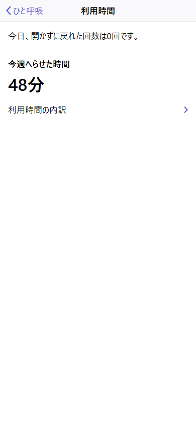
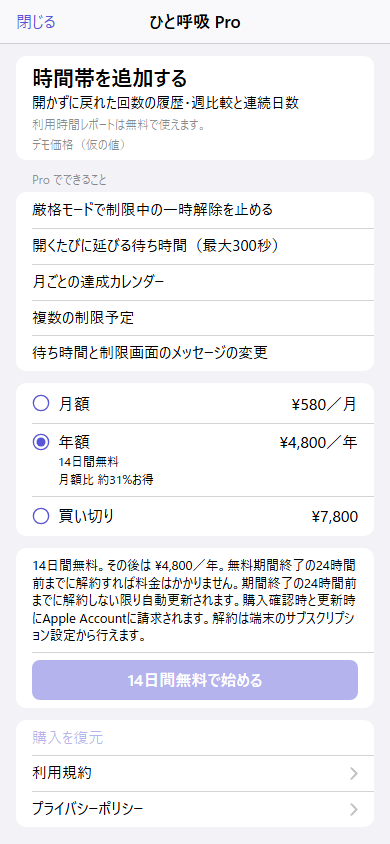
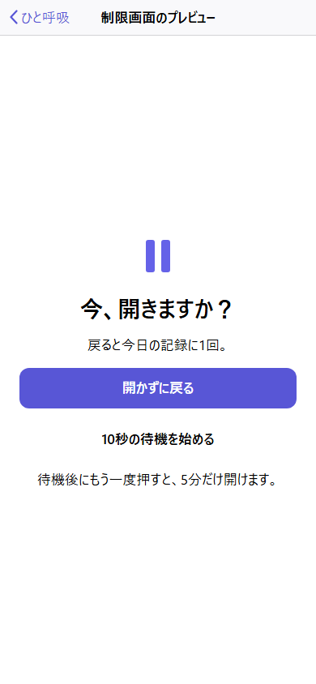

# ひと呼吸の独立批評 第7回

**総合 6.9 / 10（48 / 70）。5.7 → 6.3 → 6.9で、3回連続の停滞はありません。** 次はストア1枚目で「開く前に、10秒のひと呼吸」を見せ、利用者が初日にその操作を体験し、2日目に結果を確かめられるところまでつなげます。見た目と施策の効果はすべて **推測** です。

## 比較した画像

390×844のHTMLプレビュー4枚を現作業ツリーから再生成し、すべて開いて確認しました。現行SwiftUIと表示が違う場合は表に併記しています。iOS実機の表示、操作、Dynamic Type、VoiceOverは未確認です。

Blockinのストア画像2枚を開きました。1枚目は落ち着いた全面写真、大きな「No.1 スマホ依存対策」、月桂冠付きの「800K+」「13000+ レビュー 4.7★」を配置。実績には2025年8月の時点表記があり、順位には検索結果の脚注があります。2枚目には利用時間の推移、アプリ別の棒、残り27分、クイックブロック、月間記録が写っています。現在のストア値（4.6・19,977件）と料金（月額1,650円・年額6,600円・買い切り13,000円）は依頼時の比較資料によります。競合の購入画面とシールド実画面は未確認です。該当箇所では掲載画像で確認できた見せ方や、前回文書に記録された待機の参考パターンを比較に使っています。

## 7軸の推移

| 評価軸 | 第5回 | 第6回 | 第7回 | 第7回の根拠 |
| --- | ---: | ---: | ---: | --- |
| 初回1分（導入〜最初のブロック・許可・タップ数） | 7 | 7 | **7** | 対象を選ぶと制限を始める経路がある。初回にその時刻を毎日の予定として保存し、初回試行の案内も弱い（推測）。`App/ScreenPauseApp.swift:345-349,657-660,687-716` |
| ホームの明快さ（主指標1つ・不要情報の排除） | 5 | 5 | **6** | プレビューの0回は目に入るが、設定とデモ導線が下に続く（推測）。現行画面には終了時刻・残り時間、直接のアプリ選択、集中設定の折りたたみがある。`App/ScreenPauseApp.swift:379-489` |
| 制限・待機体験（文言・ライブ計測・段階的待機） | 6 | 6 | **6** | 「開かずに戻る」が主ボタンで選びやすい（推測）。アプリ内には計測があるが、OSシールドの待機後ラベルが固定で、再操作と5分の解除が伝わりにくい（推測）。`App/ShieldDemoView.swift:37-74`、`Shield/Shield.swift:19-50` |
| 購入画面（価値・価格・試用・復元） | 5 | 7 | **8** | 確定価格と年額の約33%差、条件と復元を同画面で確認。現行コードは購入入口別の説明、旧厳格モード利用者への案内、価格取得の再試行も備える。価値の実物と試用ボタンの強調は弱い（推測）。`App/Paywall.swift:21-105,124-159`、`App/ScreenPauseApp.swift:414-427` |
| 2〜7日目の継続（連続日数・カレンダー・レポート） | 5 | 6 | **7** | 現行コードは昨日の同時刻までと比較し、アプリ別・時間帯別のデモ例を持つ。プレビューの48分では初週の姿が伝わらず、内訳を見なければ次の制限を決めにくい（推測）。`Report/UsageReport.swift:65-82`、`App/ReportsView.swift:51-69`、`Shared/UsageReportView.swift:25-73` |
| Store公開準備（掲載文・スクショ見出し・審査メモ） | 5 | 6 | **7** | 掲載順、和文キャプション、撮影名がそろった。競合の1枚目と比べ、最初の画像だけで約束と根拠を読める掲載用の仕上げが残る（推測）。[撮影名とキャプション](app-store/screenshots.ja.md) |
| アクセシビリティ（Dynamic Type・VoiceOver・コントラスト） | 7 | 7 | **7** | 390pxでは主文字を読めた。灰色の補足文字、淡色のデモ購入ボタン、小さなカレンダー記号は確認優先（推測）。標準幅の静止画では前回のAX5懸念を解消できない。`App/Paywall.swift:45-70,90-104`、`App/ReportsView.swift` |
| **総合（7軸単純平均）** | **5.7（40/70）** | **6.3（44/70）** | **6.9（48/70）** | 前回比4点増。ホーム・購入・初週・ストアが各1点増。初回1分・制限と待機・アクセシビリティは各軸で3回横ばい。 |

総合は連続で上昇しています。横ばいの3軸は画面単体の採点から、許可 → 最初のシールド → 戻る／一時解除 → 結果確認の一連の観察へ切り替えると、どの操作で詰まるかを確認できます。通常文字と最大文字で、最初のシールドまでの時間・操作数、待機後に正しい操作を選べた割合を測ります。

## ホーム（推測）

| 要素 | Blockinで確認した見せ方 | 具体的な変更 |
| --- | --- | --- |
| 「0回」下の灰色の説明 | 2枚目はクイックブロックを「今すぐ集中」と操作で示す | 制限中かつ0回のときだけ「選んだアプリを開き、『開かずに戻る』を試す」を主指標の下に表示。戻った時に更新した回数を見せる。 |
| 「制限中」と「毎日20:00〜21:00」 | 「残り時間27分」をブロック状態の隣に表示 | 現行SwiftUIの残り時間をHTMLにも反映し、制限中は「あと○分」、制限外は次の開始時刻を1行で表示。 |
| 対象アプリの情報と変更導線 | タイマーブロックに対象アプリのアイコンを添える | 制限状態の直下にアプリ数と「制限するアプリを選ぶ」行を置く。現行SwiftUIの直接導線をプレビューにも反映し、厳格中の変更不可には理由を付ける。 |
| 「集中時間25分」「今すぐ集中を始める」 | クイックブロックをルーティンと別の操作として表示 | プレビューを現行の折りたたみに揃え、「今すぐ集中」を1行にする。展開時にだけ時間の選択と開始を表示。 |
| 「回数の履歴と連続日数」 | 月間の「ブロック記録」に日数と回数を表示 | 記録がある場合は履歴行に直近の達成日を1件添える。無料利用者には、Proへの遷移が分かる行名を表示する。 |
| 「制限画面のプレビュー」「購入画面のプレビュー」 | 掲載画像では制限や利用時間など日常の用途を見せる | ストア用ホームは最初の「開かずに戻る」を試した状態を撮り、デモ用ナビゲーション行を画像の主役から外す。 |

## 利用時間レポート（推測）

| 要素 | Blockinで確認した見せ方 | 具体的な変更 |
| --- | --- | --- |
| 「今週へらせた時間 48分」 | 日付の選択と利用時間の推移を近くに配置 | 48分の近くに実際の比較範囲を添える。初週と今週の同じ日数の比較、取得できた対応日のみの比較、同じ時間帯の比較を、計算に使った範囲どおりに表示する。`Shared/UsagePeriods.swift:42-98` |
| 48分の状態だけを見せるHTML | 日付を切り替えて利用時間を読む流れが見える | 2日目の比較と記録待ちも撮る。現行の同時刻比較は現在時を含む時間単位の集計なので、昨日の同じ時間枠が丸ごと入る可能性がある。両日とも完了した時間枠で比較し、「昨日の○時までと比較」と表示する。`Shared/UsagePeriods.swift:101-116` |
| 「利用時間の内訳」だけが見える | よく使うアプリ名と時間を棒の横に常時表示 | 最も利用したアプリ名と時間を1件見せ、残りは現行の「今週よく使うアプリ」を開いて確認できるようにする。 |
| 時間帯が見えない | 利用時間の推移を線グラフで表示 | 現行の時間帯データから最多の1時間帯を文字と数字で1行表示し、詳細行への入口を隣接させる。 |
| 冒頭の「開かずに戻れた回数は0回」 | 利用時間の図と月間ブロック記録で違う指標を見せる | 回数はホーム／履歴へ集約し、この画面の最上段を利用時間の比較にする。 |
| 利用状況を見たあとに操作がない | 同じストアパネル内に利用状況とルーティンの入口がある | 時間帯別の詳細末尾に「制限の予定を見直す」を置き、既存の予定設定を開く。 |

## 購入画面（推測）

| 要素 | Blockinで確認した見せ方 | 具体的な変更 |
| --- | --- | --- |
| 「時間帯を追加する」直下で履歴を訴求 | ストア1枚目は約束を1つに絞る | プレビューにも現行SwiftUIの入口別説明を載せる。予定からなら「曜日や時間帯ごとに予定を使い分ける」を最初に見せ、履歴は機能欄へ。 |
| 「Proでできること」の同じ強さの5行 | ストア2枚目は月間記録自体を画面で示す | 選んだ入口の価値を1点、関連画面の小さな表示例で見せる。履歴入口では月間カレンダーを使い、残りの機能は短い行にまとめる。 |
| 「月額比 約33%お得」が年額行の小文字 | 1枚目は実績数字と対象・日付を近くに置く | 「年額4,800円」の直下に「月額を12回払う場合より年2,400円お得」と表示。実アプリでは両方の価格を取得できたときに同一通貨で計算する。 |
| 購入ボタン直前の長い更新説明 | 1枚目は主張の近くに根拠を置き、詳しい条件を脚注で示す | ボタンのすぐ上に「対象の方は14日間無料、その後 年額4,800円・自動更新」を置き、更新・請求・解約条件は近接する詳細にまとめる。試用対象外は選択中の価格と更新条件を表示。 |
| 淡い「14日間無料で始める」「購入を復元」 | 2枚目のクイックブロックは操作だと判別できる | 撮影用のボタンは通常の有効時と同じコントラストで描き、購入できない撮影モードは操作側で止める。本番の価格読込中・復元中は待ち状態を文字で示す。 |

## シールド（推測）

| 要素 | 比較対象の見せ方 | 具体的な変更 |
| --- | --- | --- |
| 「今、開きますか？」と汎用の一時停止記号 | Blockinの1枚目は目的を大きく提示 | ストア用の見出しに「開く前に、10秒のひと呼吸」を置き、その直下に実際の2つの選択肢が読める大きさで写す。 |
| 「開かずに戻ると、今日の回数に加わります」 | Blockinは月間記録を実際の画面で見せる | 説明を「戻ると今日の記録に1回」に短縮し、アプリ内デモでは戻った直後にホームの数字が増えるところまで見せる。 |
| 副ボタン「10秒待って開く」 | Blockinはブロックカードで時間と操作を区別している | 押下前を「10秒の待機を始める」にし、待機完了後は一時解除の操作を別文言にする。デモ、説明文、掲載用画像のラベルを揃える。 |
| 待機中の次の操作 | 第6回で比較した参考パターンは待機の進み具合と次の操作を提示 | OSのシールドは動くタイマーを置けないため、押下後に再描画できるか確かめた上で解除可能時刻を表示。再描画できない場合は最初から「待ってからもう一度押す」を書く。アプリ内デモでは残秒と完了を表示。 |
| 解除時間が分からない | Blockinはブロックの残り分数を掲載画像で明示 | 一時解除を選ぶ時点で「待機後にもう一度押すと5分間開ける」と表示。厳格モードでは一時解除の行を出さず、確認できる終了時刻を示す。 |
| 待機前の標準状態しか撮っていない | Blockinは同じ画像に稼働中のブロックと記録を写す | 標準の押下前に加え、待機中・完了・厳格を別々に撮る。Proの段階延長は実設定に対応する「今日3回目・40秒」のような例で確かめる。 |

## ストア掲載のキャプション（推測）

掲載順は「開く前に、10秒のひと呼吸」→「選んだアプリに、1時間の制限を設定」→「今日、開かずに戻れた回数」→「よく使うアプリと時間帯がわかる」→「Proで、開かずに戻れた日を振り返る」です。最初の画像の根拠には標準設定の10秒と実際の選択肢を使います。集計実績は計測後に対象・期間・出典がそろった数字だけを使います。4枚目は内訳が見える状態、5枚目はカレンダーが見える状態に撮り直してから掲載します。 [撮影名とキャプション](app-store/screenshots.ja.md)

## 優先順位（効果は推測）

獲得はストア閲覧→インストール、購入は購入画面→試用開始／購入を指します。継続は導入2〜7日目の利用。数値は未計測です。

| 順位 | 変更 | 獲得・購入への期待 | 2〜7日目への期待 |
| ---: | --- | --- | --- |
| 1 | ストア1枚目を「10秒」とシールドの2択で組む | 獲得 **大**。サムネイルから用途と仕組みを説明できる | 中。ダウンロード時の期待が初回体験とそろう |
| 2 | 初回1時間と毎日の予定を分け、初日にシールドを試す導線を出す | 購入 中。有料機能を見る前に基本体験が伝わる | **大**。初回価値を体験し、翌日に意図しない制限に遭うのを防ぐ |
| 3 | 初週レポートの同時刻比較、最多アプリ・時間帯と予定見直しをつなぐ | 購入 中。続けて使う場面を想像できる | **大**。2日目から振り返りと翌日の調整ができる |
| 4 | シールドで待機開始・完了・5分解除を伝える | 購入 中。標準の待機を理解してからProの段階延長を検討できる | **大**。繰り返しの迷いや連打を減らせる |
| 5 | 購入入口に合う機能の表示例を見せる | 購入 **大**。価格を見る段階で求めた機能を確認できる | 中。購入後に使い始める機能が明確になる |
| 6 | 年額の支払い条件と試用ボタンを近づける | 購入 **大**。請求時期と支払額の確認がしやすい | 小。試用期間と課金条件の誤解を減らせる |
| 7 | ホームの制限状態、残り時間、対象アプリをまとめる | 購入 小。制限の仕組みが伝わる | 中。毎日の確認と対象の変更が早くなる |
| 8 | 3〜5枚目を回数更新・内訳・カレンダーの表示例で撮る | 獲得 中。1枚目で関心を持った人が機能を確認できる | 中。初週にどこを見ればよいか事前に分かる |

## 再生成の記録

`node tools/preview/render.mjs` は終了コード0。既存レンダラーの `--disable-gpu` とローカルHTMLを使用しました。外部素材のURLはなく、この生成でWeb取得は実施していません。Chromium自身のバックグラウンド通信は計測していません。出力ログは `tmp/critic-r7-render.log`。寸法とSHA-256は生成後の画像から確認しました。

| 開いたファイル | 寸法 | バイト | SHA-256 |
| --- | --- | ---: | --- |
| `docs/preview/home-390.png` | 390×844 | 35,996 | `c7cbddeb7ab3896fa1dacad62b33bf0f49de7e146c87e20251345679a648dcce` |
| `docs/preview/report-390.png` | 390×844 | 16,002 | `00c7b051ba36fb9b07856a246ad553be35604c782c3804aff84c7b596de69b09` |
| `docs/preview/paywall-390.png` | 390×844 | 57,079 | `fecb8df932d62a9644217d1eab1ea563ca6d22ee0c8afa870ee33096ab13a95f` |
| `docs/preview/shield-390.png` | 390×844 | 24,549 | `443821447ef605db2843f1b1fa0e7fbc374d29a47bfaaa427a8998e1acb01eba` |
