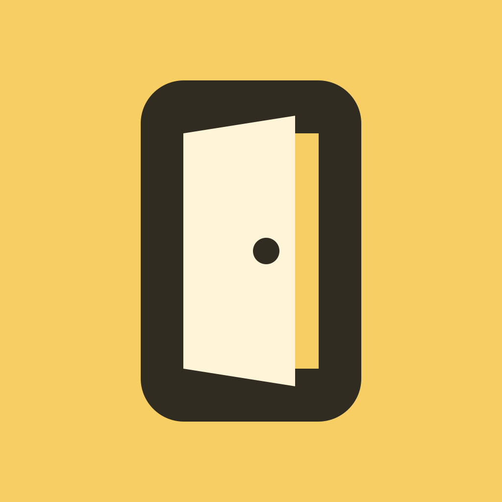

# ひと呼吸のアイコン候補

| A | B | C |
| --- | --- | --- |
|  |  |  |

- **A　ひと呼吸**（#F4F1E8、#C5DBC8、#234D42）円の中の一時停止マークで、アプリを開く前の短い間を伝える。
- **B　待ったの手**（#A23E2D、#FFF1DC）手のひらを向ける仕草で、無意識のタップをいったん止める。
- **C　閉じかけの扉**（#F6CE64、#302C21、#FFF4D7）スマホの中の扉で、アプリを開くか選び直せることを示す。

日本のApp Storeで並ぶと、黒地に銀の輪のOpalや青紫の欠けた輪のone secに対し、Aは淡い地色と濃い二本線、Bは赤茶と手の輪郭で見分けられる。Forestの黄緑の芽の隣では、Cの黄地と縦長の扉が目印になる。 [Opal](https://apps.apple.com/jp/app/id1497465230)・[one sec](https://apps.apple.com/jp/app/id1532875441)・[Forest](https://apps.apple.com/jp/app/id866450515)
