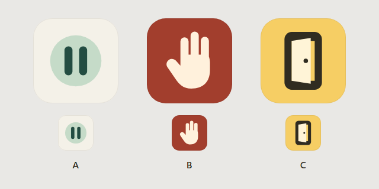

# プレビュー画像

## 画面プレビュー（推測・HTML 近似）

以下の画面 PNG（`*-390.png`）は、実機や iOS シミュレータで描画したものではなく、SwiftUI ソース（`App/`、`Shared/`、`Shield/`）の文言・階層・色・デモデータを写した **HTML の近似プレビュー（推測）** です。実機の余白・フォントメトリクス・セーフエリア・システムコントロールの細部は iOS 描画と異なります。

### 画像一覧（幅 390px × 高さ 844px）

- `home-390.png` — ホーム画面（`SetupView.homeForm` デモ状態）
- `report-390.png` — 利用時間画面（`ReportsView` / `UsageReportView` デモ状態）
- `paywall-390.png` — 購入画面（`Paywall` デモ状態・年額選択時）
- `shield-390.png` — 制限画面のプレビュー（`ShieldDemoView` / `ShieldAppearance`）

### 再生成コマンド

ネットワーク接続や追加パッケージのインストールは不要です（ローカルの Chromium 系ブラウザを `--headless=new --disable-gpu` で実行します）。

```sh
node tools/preview/render.mjs
```

---

## アイコン候補プレビュー

AppIcon 候補（A・B・C）を 144px と 60px で並べた比較用 PNG を生成します。



### 再生成コマンド

```sh
node tools/preview/render-icon-candidates.mjs
```

- 入力: `docs/icon/candidates/a.svg`, `docs/icon/candidates/b.svg`, `docs/icon/candidates/c.svg`
- 出力: `docs/preview/icon-candidates.png`
- 動作環境: Node.js とローカルの Chrome / Edge（`--headless=new --disable-gpu`、通信なし・追加インストールなし）。別の実行ファイルを使う場合は環境変数 `CHROME_PATH` を指定します。
